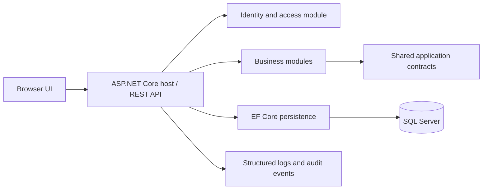

# Common Web Platform - Architecture and Technical Specification

## Architecture Principles

- Start as a modular monolith with explicit module ownership and internal interfaces.
- Keep domain logic independent from web and persistence concerns where practical.
- Prefer boring, well-supported tools and a single deployable application.
- Tenant context is resolved at the request boundary and enforced in application/data access.
- Extract a service only when a demonstrated scale, deployment or team boundary justifies it.

## Accepted Backend Baseline and Deferred Frontend Choice

| Area | Recommendation | Reason / evaluation |
|---|---|---|
| Backend | .NET 10 LTS, ASP.NET Core, C# | Supported LTS baseline; .NET SDK 10.0.300 is installed locally. |
| Data access | EF Core 10 with the SQL Server provider | Migrations and typed relational persistence; target the supported EF Core major matching .NET 10. |
| Database | Microsoft SQL Server | Matches the required SSMS workflow and .NET/EF Core stack. A locally installed SQL Server Database Engine is required; confirm edition and connection details before setup. |
| Frontend | React + TypeScript + Vite or Blazor | Preserve both options; choose only after the backend Swagger contract is verified and the comparison prototype is assessed. |
| UI | Accessible component library selected after prototype (candidate: MudBlazor if Blazor, or a React library) | Avoid premature design-system lock-in. |
| API | Versioned REST/JSON, built-in ASP.NET Core OpenAPI with Swagger UI in development | Simple integration path for framework and SaaS consumers; Swagger contract is verified before frontend selection. |
| Tests | xUnit and ASP.NET integration tests; frontend test tooling selected after API contract | Test business rules and tenant boundaries early. |
| Local runtime | SQL Server LocalDB for development, managed with SSMS; app run from IDE/CLI | Uses the installed SQL Server workflow; no paid cloud service is required. |

Use the .NET 10 LTS target and pin external package versions in project manifests. The API uses ASP.NET Core's built-in OpenAPI generation and Swagger UI only in development. The local default is SQL Server LocalDB with Windows authentication. SSMS is the database management client; a SQL Server Database Engine must also be installed and running.

## Runtime Shape



The host composes modules. Modules may depend on shared primitives and declared contracts, but must not reach into another module’s tables or internal classes. Cross-module workflows use application interfaces or explicit events within the process; no message broker is needed initially.

## Proposed Repository Structure

```text
common-web-platform/
  docs/MarkDowns/              # This planning set
  src/
    Platform.Api/              # HTTP endpoints, auth middleware, composition, OpenAPI
    Platform.Web/              # Frontend app; framework choice pending prototype
    Platform.SharedKernel/     # Small shared primitives only
    Modules/
      Identity/                # Identity, membership, roles, permissions
      Tenancy/                 # Tenant lifecycle and tenant context
      Audit/                   # Audit records and query interfaces
      Notifications/           # In-app/email abstractions, later
      Files/                   # Metadata and storage abstraction, later
      Settings/                # Tenant and platform settings
  tests/
    Platform.UnitTests/
    Platform.IntegrationTests/
    Platform.Web.Tests/
  infra/local/                 # Local SQL Server connection/setup guidance and configuration
```

Each module can contain `Domain/`, `Application/`, `Infrastructure/` and `Api/` folders only where complexity warrants them. Avoid empty layers and generic repository abstractions without a concrete need.

## Module Contract

Each module owns its domain model, persistence mapping and migrations or schema ownership, service registration, authorization requirements, API endpoints, tests and concise usage documentation. Shared kernel stays small: identifiers, clock abstraction and common result/error types only. A module must declare required modules, tenant scope, permissions, data retention and integration points.

## Frontend Evaluation

After the backend Swagger contract works locally, build a small authenticated admin shell in React/TypeScript and Blazor, compare accessibility, forms/tables, API integration, build/run complexity, component ecosystem and solo-maintenance cost. Record the result in `DecisionLog.md` before establishing the production frontend project structure. Keep both options available until that comparison is complete.


